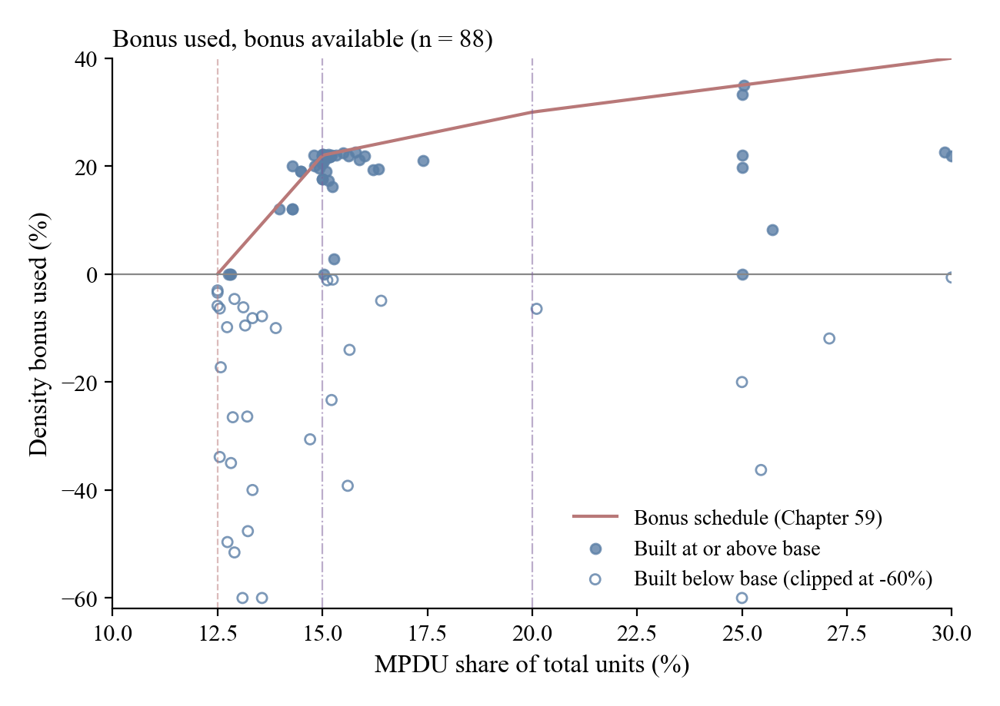
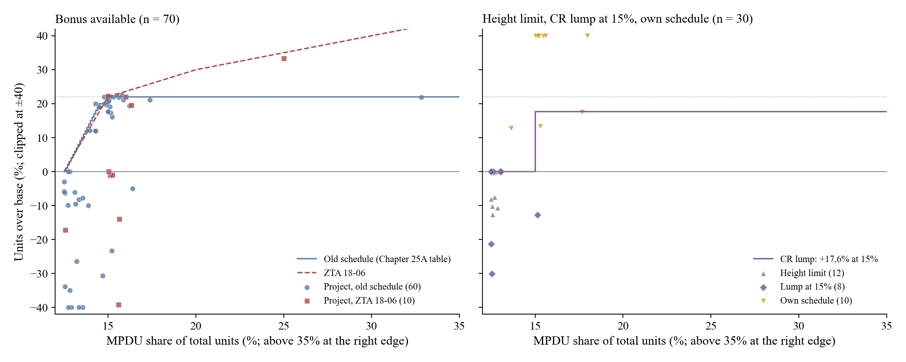

# MPDU dataset, Nov 10 2026

## Main changes since the Oct 29 pipeline

- **One row per project.** 219 report rows → 206 (13 projects listed twice, `project_fixes.csv`) → 186 (phases of one plan summed: 10 plan groups, e.g. Cabin Branch, Clarksburg Village, Park Potomac, North Bethesda Center).
- **Every base read against its Planning Board document.** 351 hand-coded rows appended to `manual_coding.csv` (346 → 697); Audrey's rows unchanged. 2 of 178 bases have no data table online.
- **Each project grouped by the rule it faced** (`08`): bonus available; ceiling at base (33 rezoning or plan caps that include the MPDUs, CR points); height limit; CR lump at 15% (2014 rule); own schedule (Bethesda Overlay, RE-1); other program; unclear.
- **Old or new schedule** from the site plan acceptance date (before or after 31 Oct 2018); Strathmore Square kept at the 12.5% minimum (sketch plan before Bill 38-17).
- **Report units corrected** where the documents disagree (`total_fixes.csv`): Maple Ridge 67 → 59, Reserve at Fair Hill 113 → 133.
- **Flags, nothing dropped:** subsidy, 25% impact-tax share, TDRs, other programs, 15% minimum areas.
- **Open:** caps equal to base × 1.22 (7001 Arlington, Reserve at Fair Hill, Brody, Avalon, Layhill Overlook); rounding the base to whole units (moves 3 positions); calls 3 and 12.

## Samples

| Sample | Projects |
|---|---|
| Report rows | 219 |
| Listed twice counted once | 206 |
| **All:** plan groups counted once | 186 |
| **Base:** with a resolution base | 178 |
| **Bonus:** MPDUs could buy units above base | 90 |
| **Choice:** bonus, no subsidy, no 25% impact-tax share, 12.5% minimum | 65 |
| **Wedge:** faced a known price for density and chose its own share | 100 |

## Position against base, by group

| Group | Below base | At base | Between | At 22% | Above 22% | Total |
|---|---|---|---|---|---|---|
| Bonus available | 34 | 7 | 18 | 29 | 2 | 90 |
| *of which choice* | *20* | *4* | *13* | *27* | *1* | *65* |
| Ceiling at base | 16 | 28 | 0 | 0 | 0 | 44 |
| Height limit | 5 | 7 | 0 | 0 | 0 | 12 |
| Lump at 15% | 5 | 5 | 1 | 0 | 1 | 12 |
| Own schedule | 0 | 0 | 3 | 0 | 7 | 10 |
| Other program | 0 | 1 | 1 | 0 | 4 | 6 |
| Unclear | 1 | 2 | 0 | 0 | 0 | 3 |
| Base from approved units | 0 | 1 | 0 | 0 | 0 | 1 |
| **Total** | **61** | **51** | **23** | **29** | **14** | **178** |
| *Wedge sample* | *30* | *18* | *17* | *27* | *8* | *100* |

## Figures

Evan's figures (`02`, `04`, `07`), drawn on the 186 projects instead of the 219 report rows (`11_dataset_figures.py`).

## Estimation sample: the wedge sample (100)

Projects that faced a known price for density and chose their own MPDU share (`08` `wedge_sample`): bonus available 70, height limit 12, CR lump at 15% 8, own schedule 10. Each project's position gives a bound on its wedge w, in MPDU discounts d (`10_wedge_bounds.py`).

| Position | Bound on w | Projects |
|---|---|---|
| Below base, or a 15% minimum below 22% | w = 0 | 33 |
| At base, old schedule | 0 ≤ w ≤ 0.100 | 4 |
| At base, CR lump at 15% | average w ≤ 1/6 | 5 |
| At base, height limit | w ≥ 0, no upper bound | 7 |
| Between, old schedule (below a 20% bonus) | exact, 0.124-0.138 | 9 |
| At 20%, old schedule (14.5% MPDUs) | 0.140 ≤ w ≤ 0.325 (average over the last step) | 2 |
| At 22%, old schedule | average w over the last step ≥ 0.325 | 25 |
| At 22%, ZTA 18-06 | 0.164 ≤ w ≤ 0.788 | 2 |
| Above 22%, ZTA 18-06 (Flats at Knowles Station) | exact, 1.442 | 1 |
| Inside the old last step (Reserve at Fair Hill: paid for 22%, built less) | none | 1 |
| RMX zone (Buckingham Station: each MPDU adds one unit, no market units) | not modeled | 1 |
| Own schedule (Bethesda Overlay, RE-1) | not modeled | 10 |
| **Total** | | **100** |

Old schedule: the Chapter 25A table in force until 31 Oct 2018 (Bill 34-17, pp. 19-20): a bonus up to k% needs 12.5% + 0.1k% MPDUs to 20% (14.5%), and any bonus above 20%, up to 22%, needs 15%.

{style="max-height:6.2in"}

{style="max-height:6.2in"}

## Projects

Sorted by group, then position. Base: units allowed before any MPDU bonus. Over base: units / base − 1. Rules: old schedule or ZTA 18-06.

