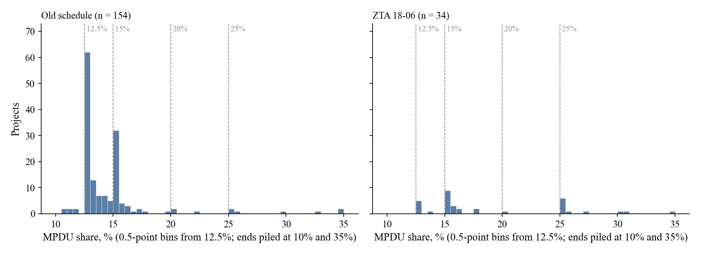
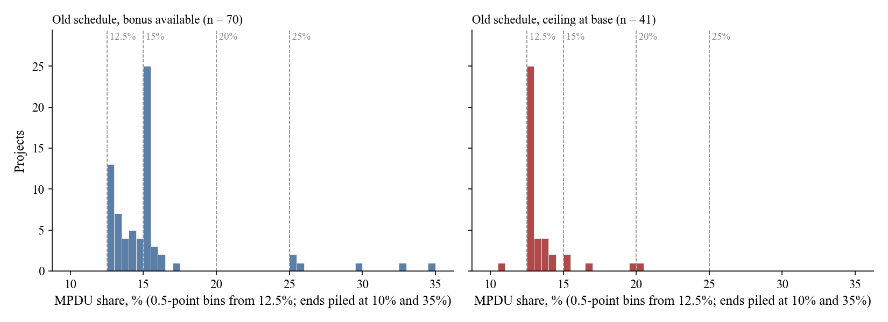
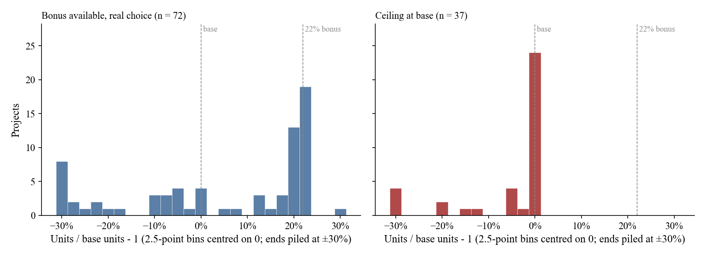
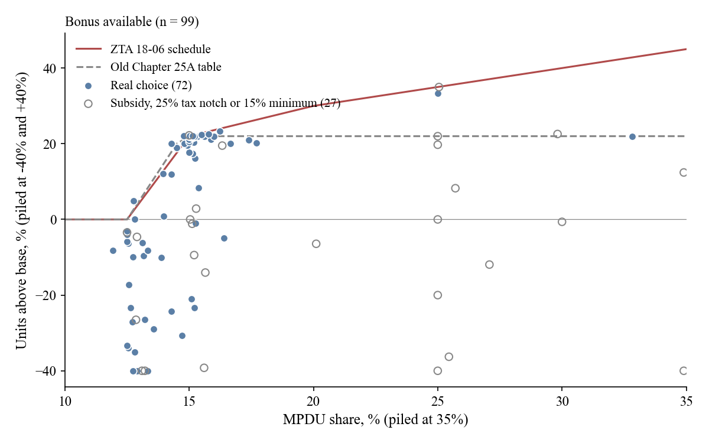
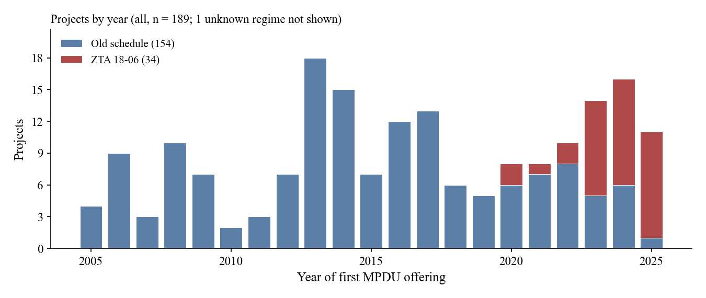
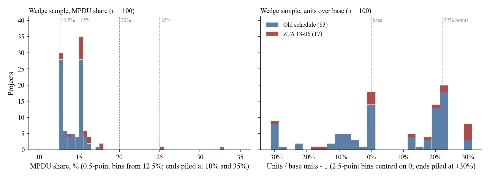

# MPDU dataset, version 1: basic descriptives (Nov 4 2026, revised twice the same day; 850 Sligo Avenue moved and Whitehall Square grouped Nov 5; bases corrected and three rezoning caps applied Nov 9; every below-base and bonus-taking wedge project checked Nov 10)

Made by `09_descriptives.py` (run by `run_all.py` after `08`). Every number below is from its tables in `output/tables/descriptives_*.csv`, and the figures are `output/figures/descriptives.pdf`. No model and no filtering: the "choice" sample is shown for reference only.

## The samples

| Sample | What it is | Projects |
|---|---|---|
| report projects | every row of the annual reports, agreements and permits | 219 |
| | projects listed twice counted once (`project_fixes.csv`) | 206 |
| **all** | phases of one plan counted once; the MPDU-share sample (needs no base) | 186 (1 with unknown regime) |
| **base** | projects with a base read from a Planning Board resolution (`08`) | 178 |
| **bonus** | base projects whose rule let MPDUs buy units above base | 90 |
| **choice** | bonus projects with no subsidy, no 25% impact-tax flag and a 12.5% minimum | 65 |
| **wedge** | base projects that faced a known price for density (bonus available, height limit, lump at 15%, own schedule) and chose their own share: no subsidy except LIHTC after completion, no 25% impact-tax share (`08` `wedge_sample`) | 100 |

**Revision.** The first version counted the MPDU-share sample by report row (206). But 8 plans set their MPDU obligation for the whole plan and the reports list their phases or buildings separately. So a phase's share isn't a choice: Cabin Branch phases run from 5% to 25%, while the plan as a whole is at 14.4%. The "all" sample now sums each such plan into one project, as `08` does for the base: the 6 plan groups `08` already had (20 rows), plus two plans whose buildings share one cap, The Perry with Park Potomac Townhomes (75 MPDUs of 600, exactly 12.5%), and The Darcy with The Flats (27 of 250, 10.8%). That makes 206 rows into 190 projects, and the base sample 182. The "all" sample also keeps Wildwood Manor, which `06` drops because its report plan number belongs to another project; its units and MPDUs are fine.

**Second revision.** The choice sample had 14 projects at base, which looked like a second pile. I read the documents for each, and for the downtown (CBD/CR) choice projects 8-13% below base. 15 had another limit and leave the bonus sample:

- **Height limit (12, a new group).** At the zone's or plan's maximum height with no more than the base floor area built, so the bonus floor area had no room. At base: Eleven55 Ripley (200 ft), Flats 8300 and Argent (90 ft), Element 28 and Cameron (143 ft), 8415 Fenton Street (at the permitted height in all three zones), Guardian (an office conversion, 138 of 145 ft). Below base: 1200 East West Highway (142 of 143 ft), The Veridian (tapered to 143 ft under the South Silver Spring guidelines), The Premier (13 storeys, "the maximum height of 143 feet"), Fenwick (60 ft required and approved, at the CBD edge) and Heritage (90 ft, the CBD-1 and overlay maximum; source a description of the proposal, not a resolution).
- **Ceiling at base (2).** The Blairs (a Project Plan ceiling) and Bentley Park (a development plan cap of 248 units including MPDUs).
- **Other program (1).** The Core went over the floor-area cap through workforce housing.

Bonus available goes from 116 to 101 and choice from 89 to 74. In the choice sample, at base falls from 14 to 4 and below base from 31 to 26. Woodward Crossing, Wootton Crossing and Woodcrest show no other limit and stay at base. Sources are in `NOTES.md`.

**Nov 5.** 850 Sligo Avenue, the last choice project at base, moves to lump at 15%. Its density was set by Sketch Plan 320180090, filed 5 Jan 2018 under the 2014 CR rule, whose binding elements fix the maximum density at 82,941 sf (3.0 FAR, the mapped maximum) and the height at 60 ft (H-60, and the Sector Plan's limit east of Fenton Street), at 12.5% MPDUs. The site plan (MCPB 19-039), filed 8 days after ZTA 18-06, keeps both. Same rule as Knowles Manor. Bonus available 101 to 100, choice 74 to 73 (3 at base); the wedge sample stays 111.

**Nov 5, later.** White Oak (82005018C, 22 townhouses, 4 MPDUs) is Phase 2 of Whitehall Square (820050180, 106, 16) and is now one plan group with it. The Phase 2 staff report (Planning Board, 22 May 2014) sets density and MPDUs for the whole plan: "Max. Number of Dwelling Units 128 (29.34 ac X 4.39)" and "Min. Number of MPDUs at 15%: 20 (16 existing + 4 proposed)". Its 3.04 added acres alone would allow 13 units. Grouped: 128 units, 20 MPDUs (15.6%), base 105 (the phases' 87 + 18), at 22%, as each phase was alone. White Oak's base was Phase 1's ratio (`base_check` borrowed); the 2014 table checks it, so it is now checked. All 189, base 181, bonus 99, choice 72, wedge 110.

**Nov 9.** The 18 wedge projects more than 15% below base were read against their documents (`NOTES.md`, Nov 9; quotes in `docs/checks_2026-11-09/`). Four bases change:

- **North Bethesda Center (G-801), a new plan group.** Wentworth House (Parcel E), Aurora (F), Arrowwood (G) and Parcel H share one development-plan cap of 1,350 units including MPDUs; 1,312 are approved, "leaving a maximum of 38" (MCPB 22-066). Each parcel had been coded on its own 500-unit limit or a floor-area estimate, so they looked 27-41% below base. As one plan: ceiling at base, 2.8% below the cap.
- **Linthicum West: ceiling at base.** The Clarksburg Master Plan recommends 225 units plus 28 MPDUs and the preliminary plan is "limited to 253"; 253 are approved. The base had been the TDR-zone maximum (330), 23% below. Same master plan and treatment as Cabin Branch.
- **North Bethesda Market: took the bonus.** Its data table shows a 76,840 sf MPDU bonus on 400,183 sf of base residential floor area, with 15% MPDUs, and 440 units, the preliminary plan's maximum. Base 369 units for the 440 (was 557 from the zone's 3.0 FAR): from 21% below base to 19% over, between.
- **Woodlake: still below base, further.** Its 593 approved units are 534 apartments from 1971 plus the 59 new townhouses; the site's base (834) less the 534 leaves 300 for the townhouses. From 29% to 80% below.

Not changed: Shady Grove Crossing's 65-unit preliminary-plan limit is the applicant's own proposal (it "does not take advantage of allowance"), so it is not a cap under call 1. All 186, base 178, bonus 96, choice 69, wedge 106.

**Nov 9, later.** A search of the wedge projects for rezonings that cap units including MPDUs (`NOTES.md`, Nov 9) found three where the cap leaves no room for the bonus. They move to ceiling at base, with the cap as the base, as Glenmont and Solaire:

- **Little Falls Place:** G-907, "no more than 30 townhouses, of which no more than five will be MPDUs"; 30 built with 5. Was at 22% (base 25 from the stated bonus); now at base (30).
- **4910-4920 Strathmore:** LMA H-143, "up to 125 ... dwelling units (including a minimum of 15% MPDUs)"; the 2024 amendment approves 125. Was 9% below a floor-area base of 138; now at base (125).
- **Clarksburg Square:** Development Plan G-832, 408 units including 51 MPDUs (the zone's 11 du/ac); 392 built. Still 3.9% below.

Strathmore Square's minimum is now 12.5%: its Sketch Plan 320190010 was accepted Aug 3, 2018, before Bill 38-17 took effect (Oct 31, 2018), and Sec. 2 of the bill keeps such applicants at the old minimum. It chose 15%, so it joins the choice sample. All 186, base 178, bonus 93, choice 68, wedge 103.

**Nov 10.** All 31 wedge projects below base were read against their documents, with the preliminary, sketch and project plans we lacked downloaded (`NOTES.md`, Nov 10; `docs/checks_2026-11-10/`). 27 bases hold. Four change:

- **Towns at Oak Hill: a missed rezoning cap.** Zoning Application G-833 (Council, 2005) binds it to "[n]ot more than 29 (twenty-nine) one-family attached [dwelling] units [, including MPDU's]"; 28 built. Ceiling at base, as Little Falls Place (was 24% below a zone-table base of 37).
- **Cabin John Village: base 61, not 52.** Its residential floor area (0.25 FAR, 254,826 sf) is set for the whole property; Phase 1's 48 townhouses get their share of it, as Northpark. From 8% to 21% below.
- **The Veridian: base 506, not 536.** The 5.0 FAR limit binds before 200 units per acre, at the building's own 1,051 sf per unit. From 13% to 7% below.
- **Maple Ridge Townhomes: 59 units, not 67.** The 2005 report's 67 is in no Planning Board document; the resolution, the county GIS and a December 2005 Planning memo ("59 townhouses including 8 MPDUs") say 59. Corrected at the source (`total_fixes.csv`, read by `01_combine_reports.py`), so every table and figure uses 59. Its 8 MPDUs are now 13.6%, at the minimum, not below it.

All 186, base 178, bonus 92, choice 67, wedge 102.

**Nov 10, later.** All 47 wedge projects between base and the 22% top, or at the top, were read against their documents the same way (`NOTES.md`, Nov 10; `docs/checks_2026-11-10/bonus_*`). Six change:

- **Arora Hills: at a development plan cap.** Development Plan G-735 caps Greenway Village at 1,330 units including MPDUs; Phases 1-2 took 486, so this site plan is "limited to 844 dwelling units". 844 built. Ceiling at base (was 0.8% over a zone-table base of 837).
- **Kensington Overlook: at a rezoning cap.** LMA G-877: "The maximum number of dwelling units shall be 27 including moderately priced dwelling units"; 26 built. Ceiling at base (was 8% over a zone-table base of 24).
- **Residences at Shady Grove: at base.** A 2016 amendment dropped the 5% bonus: "a total of 149 units" with "19 MPDUs (12.5%)", on the 149-unit base. The reports' 149 are this plan (was 4.9% over, on the 2009 approval of 156).
- **Symphony Park: at 22%.** The preliminary plan's table gives a zoning maximum of 92 and 112 "Includes 22% bonus density for providing 15% MPDUs". Base 92, not 92.7: +21.7% (was +20.4%, between).
- **Reserve at Fair Hill: 133 units, not 113.** The reports' 113 is the market-rate count; the Board's table says "113 (market rate) 20 (MPDUs) 133 units total". Corrected at the source (`total_fixes.csv`), as Maple Ridge. Its 20 MPDUs are 15.0%, not 17.7%; still between (+20.9%).
- **Batchellors Forest: base 31, not 30.3,** as the staff report states. Still at 22%.

Manor Oaks was also read: the Board gave it a 19.5% bonus (14.5% MPDUs), which is already its coded base. It shows at 22% only because the simulation rounds its base to 45 units; that moves only if the bases stop being rounded, which is still open. So is how to treat rezonings and plans whose cap already includes the full bonus (7001 Arlington, Reserve at Fair Hill, Brody, Avalon, Layhill Overlook).

All 186, base 178, bonus 90, choice 65, wedge 100.

## Who is in it

| | all | base | bonus | choice |
|---|---|---|---|---|
| Projects | 186 | 178 | 90 | 65 |
| Units, total | 46,477 | 44,563 | 18,078 | 12,888 |
| Units, median (25th-75th pct) | 170 (70-310) | 174 (70-317) | 126 (55-240) | 112 (46-222) |
| MPDUs, total | 7,256 | 6,994 | 3,304 | 1,929 |
| MPDU share, median | 14.3% | 14.3% | 15.0% | 15.0% |
| At its required minimum | 50% | 52% | 38% | 37% |
| At exactly 15% (above a 12.5% minimum) | 22% | 22% | 37% | 49% |
| 15% minimum required | 9% | 9% | 8% | 0% |
| Rental / for-sale | 47% / 51% | 48% / 50% | 39% / 59% | 32% / 66% |
| First MPDU offering, median year (range) | 2016 (2005-2025) | 2017 | 2016 | 2014 |
| Under the new rules (ZTA 18-06) | 18% | 18% | 22% | 8% |
| Tract median gross rent 2019, median | $1,802 | $1,802 | $1,781 | $1,799 |

A plan group takes its first phase's tenure, rent and minimum, its earliest offering year, and the regime of its earliest site plan. The base sample loses little: 178 of 186 projects, and 96% of the units. The choice sample is smaller, older and more for-sale: 54 of its 65 projects had their site plans accepted before the October 2014 zoning rewrite.

## 1. MPDU share: the pile at 15%

"At x%" is counted in units: a project is at 15% when its MPDUs equal the fewest that reach 15% of its units, so rounding doesn't move it.

| MPDU share | Old schedule | New (ZTA 18-06) | Total |
|---|---|---|---|
| Fully affordable | 1 | 1 | 2 |
| Below its minimum | 5 | 0 | 5 |
| At its minimum (12.5%, or 15% where required) | 78 | 15 | 93 |
| Between the minimum and 15% | 19 | 0 | 19 |
| At 15% | 37 | 3 | 41 |
| 15-20% | 3 | 3 | 6 |
| At 20% | 2 | 1 | 3 |
| 20-25% | 1 | 0 | 1 |
| At 25% | 3 | 7 | 10 |
| Above 25% | 3 | 3 | 6 |
| **Total** | **152** | **33** | **186** (incl. 1 unknown) |

Under the old schedule the bonus stopped at 15% MPDUs. 37 projects stop exactly there, against 19 spread over the whole range from the minimum to 15% and 3 over 15-20%. Summing phases took "below its minimum" from 13 to 6 (5 since Maple Ridge's units were corrected, Nov 10): most were phases of plans whose MPDUs sit in other phases. Under the new rules there are only 33 projects. Their 15% pile is mostly the 15% minimum areas, and 7 of the 33 are at 25%, the impact-tax notch.

### Only where the bonus was available

The old-schedule sample mixes projects that could buy units with MPDUs and projects whose base was a hard ceiling (group from `08`'s zone and date rules; 6 projects have no resolution, so no group).

| MPDU share, old schedule | Bonus available | *of which choice* | Ceiling at base | Height limit | Lump at 15% | Other groups | No resolution base | Total |
|---|---|---|---|---|---|---|---|---|
| Fully affordable | 1 | *0* | 0 | 0 | 0 | 0 | 0 | 1 |
| Below its minimum | 0 | *0* | 1 | 0 | 0 | 2 | 2 | 5 |
| At its minimum | 27 | *23* | 27 | 12 | 6 | 6 | 0 | 78 |
| Between the minimum and 15% | 6 | *6* | 9 | 0 | 1 | 2 | 1 | 19 |
| At 15% | 30 | *29* | 2 | 0 | 2 | 2 | 1 | 37 |
| Above 15% | 6 | *2* | 2 | 0 | 1 | 1 | 2 | 12 |
| **Total** | **70** | ***60*** | **41** | **12** | **10** | **13** | **6** | **152** |

This is the cleanest picture of the 15% pile. Where MPDUs bought units, 30 of 70 projects stop exactly at 15%. Where base was a ceiling, 2 of 41 do, though both faced the same 12.5% requirement; one is Little Falls Place, whose rezoning fixed its 5 MPDUs of 30. The ceiling projects pile at the minimum instead (27 of 41), and so do all 12 at a height limit. So the 15% pile is about the bonus, not a habit of offering 15%.

What this changes for any later use of the share:
- **The sample for the bonus schedule is about 60 to 70 projects, not 152.** That's 70 bonus-available old-schedule projects, 60 of them with no subsidy, impact-tax flag or 15% minimum.
- **The interior is thin.** Of the 19 projects between the minimum and 15%, only 6 could buy units, and four of those are small projects one MPDU over the minimum (Leaman Farm, Trotters Glen, Tapestry, Manor Oaks: 54-69 units, where one MPDU is 1.5-1.9 points of share). Only Thayer & Spring (9 over) and Citron (3) are interior by more than rounding. Arora Hills (12 over) was the third, until it turned out to be at its development plan's cap (Nov 10).
- **Ceiling-at-base projects above the minimum (9).** They give MPDUs that buy nothing under our rule: Cabin Branch (35 over the minimum, 14.4% plan-wide), Arora Hills (12), Mallory Square (7), Hanover Shady Grove (4), Solaire Wheaton (3), and AVA Wheaton, Amalyn, Pike & Rose and North Bethesda Center (1 each, rounding). Cabin Branch is worth a look at its development plan's MPDU condition; the rest are not checked.

### The 14.5-15% gap

The old table gives 20% at 14.5% MPDUs and 22% at 15%, nothing in between. So no one should stop strictly between. Counted in units, one project does: Thayer & Spring, 59 MPDUs of 399 (14.79%; 15% needs 60). It took the full 22% (base 327), so the Board treated it as meeting 15%. Its resolution is worth checking. Manor Oaks (8 of 54) and Tapestry (10 of 67) have the fewest MPDUs that reach 14.5% and took 20%, as the table says. Trotters Glen and Leaman Farm (10 of 69, 14.49%) took 19%, also as the table says.

The last step of the table is pricier than the rest: 2 points of bonus for 0.5 points of MPDUs, about 0.45 MPDUs per extra unit against about 0.27 just before. That makes 14.5% a second, small kink; the model sketch's straight line ignores it.

## 2. Building size: no bonus or the full bonus

Position is units built against the base (the most units before any MPDU bonus).

| Group | Below base | At base | Between | At 22% | Above 22% | Total |
|---|---|---|---|---|---|---|
| Bonus available | 34 | 7 | 18 | 29 | 2 | 90 |
| *of which choice* | *20* | *4* | *13* | *27* | *1* | *65* |
| Ceiling at base | 16 | 28 | 0 | 0 | 0 | 44 |
| Height limit (only CBD/CR at or just below base checked) | 5 | 7 | 0 | 0 | 0 | 12 |
| Lump at 15% (2014 CR rule) | 5 | 5 | 1 | 0 | 1 | 12 |
| Own schedule (Bethesda Overlay, Tregoning) | 0 | 0 | 3 | 0 | 7 | 10 |
| Other program | 0 | 1 | 1 | 0 | 4 | 6 |
| Unclear | 1 | 2 | 0 | 0 | 0 | 3 |
| Base from approved units | 0 | 1 | 0 | 0 | 0 | 1 |

Among the 65 choice projects, the pile is at the full 22% (27), with only 3 projects between +5% and +15%. At base there are now only 4, against 20 below: before the second revision the 14 at base looked like a second pile, but 11 of them were stopped by height, a plan cap, another program or the CR lump rule. So few projects that could use the bonus stop exactly at base; the downtown projects at or just below base were at a height limit, not refusing the bonus. Where base is a hard ceiling (right panel), 28 of 44 sit at it and none go above, as they shouldn't. The height-limit group is selected on position (only downtown projects at or just below base were checked), so it is not a comparison group. Of the 13 "between" projects, 10 are just short of the top, at 16-21%.

## 3. The two margins line up

If the data are right, a project at 15% MPDUs should have taken the full bonus, and one at its minimum should be at or below base. For the 90 bonus-available projects:

| MPDU share | Below base | At base | Between | At 22% | Above 22% | Total |
|---|---|---|---|---|---|---|
| At its minimum | 24 | 6 | 3 | 1 | 0 | 34 |
| Minimum to 15% | 0 | 0 | 4 | 2 | 0 | 6 |
| At 15% | 2 | 0 | 8 | 23 | 0 | 33 |
| At 25% | 3 | 1 | 2 | 1 | 2 | 9 |
| Other | 5 | 0 | 1 | 2 | 0 | 8 |

Mostly they do. 23 of the 33 at 15% MPDUs are at 22%, and 30 of the 34 at the minimum are at or below base. The exceptions are explainable or worth a look:
- **At the minimum, but above base (4).** Two are small projects where the 12.5% minimum rounds up to 14% (4 MPDUs of 28 units: Bethesda Crest, Hallman Grove), which earns part of the bonus. One has a 15% minimum, whose bonus starts there (12710 Twinbrook Parkway). Strathmore Square was the second until its minimum became 12.5% (Nov 9). Olney Estates is call 12. Two more were coding errors (Nov 10): Kensington Overlook is at its rezoning's 27-unit cap, and Residences at Shady Grove's 2016 amendment dropped its bonus, so it is at base.
- **At 15%, but below base (2).** Grosvenor Place (−23%; its data table's 73-unit maximum includes the bonus, so the base 59.8 is checked) and White Oak Apartments (−1%, essentially at base; its 15% is a binding element of its rezoning, LMA H-141). North Bethesda Market was the third: its zone-table base was too high, and with the data table's floor areas it took a 19% bonus (Nov 9).

The scatter shows the same thing against the two bonus schedules: the choice projects (filled) sit on the schedule or at its 22% top, or below base at the 12.5% minimum.

## 4. Flags, by group

| Group | Projects | TDRs or transfer | Subsidy | 25% impact tax | 15% minimum | Other program | Base not checked |
|---|---|---|---|---|---|---|---|
| Bonus available | 90 | 14 | 15 | 5 | 7 | 0 | 0 |
| Ceiling at base | 44 | 4 | 2 | 1 | 1 | 0 | 0 |
| Height limit | 12 | 0 | 0 | 0 | 0 | 0 | 2 |
| Lump at 15% | 12 | 0 | 3 | 1 | 0 | 0 | 0 |
| Own schedule | 10 | 0 | 0 | 0 | 8 | 7 | 0 |
| Other program | 6 | 1 | 3 | 1 | 0 | 6 | 0 |
| Unclear, base from approved units | 4 | 0 | 0 | 0 | 0 | 0 | 0 |
| **Total** | **178** | **19** | **23** | **8** | **16** | **13** | **2** |

Subsidy excludes "LIHTC after completion" (The Argent, now in height limit), whose share the market developer set.

## 5. The choice sample, by period and tenure

| | Below base | At base | Between | At 22% | Above 22% | Total |
|---|---|---|---|---|---|---|
| Before Oct 2014 | 14 | 4 | 13 | 23 | 0 | 54 |
| Oct 2014 - Oct 2018 | 4 | 0 | 0 | 2 | 0 | 6 |
| From Oct 2018 | 2 | 0 | 0 | 2 | 1 | 5 |
| For-sale | 16 | 3 | 9 | 15 | 0 | 43 |
| Rental | 3 | 1 | 4 | 12 | 1 | 21 |
| Tenure unknown | 1 | 0 | 0 | 0 | 0 | 1 |

The building-size evidence is almost all pre-2014. The 2014-18 period is thin because most CR projects then faced the lump rule instead of the unit bonus. After 2018 it's thin because many new projects are in 15% minimum areas or subsidized. Rentals no longer sit at base more often than for-sale projects (1 of 21 against 3 of 43); the earlier gap (9 of 35 against 5 of 53) was the downtown rentals at their height limit.

## 6. The wedge sample, all together

The figures above each show one slice: the MPDU-share figures cover all 186 projects (no base needed), the building-size figures the bonus or choice samples. The wedge sample is the 100 base projects that faced a known price for density and chose their own share (`wedge_sample`): bonus available 70 (old 60, new 10), height limit 12, lump at 15% 8, own schedule 10; 83 under the old schedule and 17 under ZTA 18-06.

| Group | Below base | At base | Between | At 22% | Above 22% | Total |
|---|---|---|---|---|---|---|
| Bonus available | 22 | 6 | 14 | 27 | 1 | 70 |
| Height limit | 5 | 7 | 0 | 0 | 0 | 12 |
| Lump at 15% | 3 | 5 | 0 | 0 | 0 | 8 |
| Own schedule | 0 | 0 | 3 | 0 | 7 | 10 |
| **Total** | **30** | **18** | **17** | **27** | **8** | **100** |

The share piles at 12.5% (30 projects in the 12.5% bin) and 15% (35). In units over base, 27 are at the 22% top and 18 at base, 12 of those 18 at a height limit or under the 2014 CR lump rule. The 8 above 22% are mostly Bethesda Overlay projects, which buy density on their own schedule.

## What these don't show yet

- **Geography.** Planning area is carried in `08` but not tabulated here.
- **The 20 choice projects below base.** 7 of them are more than 30% below. Every wedge project below base has now been read (Nov 9 and 10, `NOTES.md`). Their bases hold, so the question left is what stopped them. Another rule binds in three: Cloverly Forest (an 8% impervious-surface limit), Fairland View (the Intercounty Connector took 6.58 of 12.08 acres) and Orchard Run (cut from 49 to 45 after environmental staff recommended disapproval). A reason is stated for a few more: The Astrid ("geotechnical constraints ... and the economic feasibility"), Cabin John Village (keeping the shopping center), Northpark ("shift in unit type due to current market conditions"), Shady Grove Crossing (compatibility with Washington Grove), Eton Square (the applicant: a master-plan road and MD 355 dedication), and the five height-limit projects (at their zone's height). Of the 30 wedge projects still below base, the other 17 state no reason or only a weak one.
- **The choice projects still at base (4).** Woodward Crossing, Wootton Crossing and Woodcrest (no other limit found; Wootton Crossing's approval even lists the bonus density, 9.76 du/ac, and it built 7.98), and since Nov 10 Residences at Shady Grove, whose 2016 amendment gave up a 5% bonus (no reason stated in what we read).
- **Two open decisions from the Nov 10 read (Jacob).** Caps that already contain the full bonus (7001 Arlington and Reserve at Fair Hill, both between; Brody, Avalon Residential, Layhill Overlook, at 22%), and whether position should use the unrounded base (moves Manor Oaks to between, 2115 East Jefferson just below base, and Towns at Oak Hill within its ceiling).
- **Open calls 3 and 12.** These are Evan's. Call 3 moves Clarksburg Village; call 12 drops Olney Estates if coded at 14.3%.
